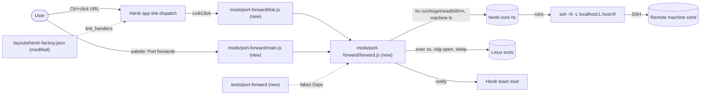

# Automatic Port Forwarding Specification

## Intent and Delivery Scope

- **Intent:** Supplied in conversation on 2026-11-24. The user asked: "I've noticed that Rex has a demo with automatic port forwarding between remotes. What options do we have to apply the same pattern in a custom Mod in Herdr app?" After the exploration, the user concluded: "So, basically we would have to configure a port forward automatically when a link is clicked in the terminal, or allow users to manually configure them from a dialog", then invoked `/quickie`.
  - Synthesis: build both entry points that the exploration proposed and the user restated. A link click forwards a port automatically, and a dialog lets the user configure forwards by hand. Both share one forwarding core. "Or" is read as the two ways the user named, not as a choice between them.
- **Outcome:** In the `herdr-factory` layout, Ctrl+clicking a `localhost` URL printed by a program on a remote SSH machine opens that page in the local browser through an SSH forward. A "Port forwards" dialog adds, lists and stops forwards.
- **Includes:**
  - A Ctrl+click on a loopback URL with an explicit port, in a terminal on a remote machine, starts a forward and opens the URL.
  - A Ctrl+click reuses a live forward for the same machine and port.
  - A Ctrl+click in a local terminal keeps Herdr's existing behavior.
  - A failed forward shows an error notification, does not open the browser, and leaves no forward process.
  - A command-palette entry opens the "Port forwards" dialog.
  - The dialog lists live forwards.
  - The dialog adds a forward for a chosen SSH machine, remote port and local port.
  - The dialog stops a listed forward.
- **Constraints:**
  - The feature is a custom Mod in this repository, run by the Herdr app (user statement).
  - Mods cannot open sockets or use Node APIs. They can run programs (`exec`, `hc`) and fetch URLs. `exec` has a 30 s default and a 10 min maximum timeout (`~/.config/herdr-app/AGENTS.md` "What you can and can't do", `herdr.d.ts` `exec`). The forward therefore runs as an external `ssh` process in a herdr-core terminal.
  - A link handler must answer within 30 s (`AGENTS.md` "Terminal link handlers").
  - Mods have no `setTimeout` (`AGENTS.md` "A mod" rules).
  - This repository is a personal Linux setup: Omarchy, `xdg-open` in `mods/acp-view/main.js:689`.

### Definition of Done

- **DoD-1** (human, derived) — With a reachable SSH machine, Ctrl+clicking `http://localhost:<port>` printed by a program in a terminal on that machine opens the page in the local browser. The page arrives through a forward that listens on loopback addresses only.
  - Covered by: FR-1, FR-2, FR-4, NFR-1, NFR-2, NFR-3. Human review criterion: the user saw the page open in the browser, the captured `curl` output contains the remote server's marker, and the captured `ss` output lists only `127.0.0.1` and `[::1]` listeners.
- **DoD-2** (human, derived) — From the "Port forwards" dialog, the user adds a forward for a chosen SSH machine and ports, sees it listed, and stops it.
  - Covered by: FR-5, FR-6, FR-7, FR-8. Human review criterion: the captured screenshots show the new forward's row after Add and no row after Stop, and the captured `hc ls` output matches each screenshot.
- **DoD-3** (checkable, derived) — Ctrl+clicking a loopback URL in a local terminal keeps Herdr's existing behavior.
  - Covered by: FR-3.

## Functional Requirements

- **FR-1** — The system must start a forward and open the URL when the user Ctrl+clicks a loopback URL with an explicit port in a terminal on a remote SSH machine.
  - Selection: included
  - Source: user statement ("configure a port forward automatically when a link is clicked in the terminal").
  - Verification: Given the click `{link: {kind: "url", url: "http://localhost:5173/app"}, source: {machine: "framework"}}`, the SSH machine `{name: "framework", target: "cosmincartas@framework", via: false}`, no forward for local port 5173, and the local port becoming listened on after start, when `handleClick` runs, then `hc` receives exactly the [Forward start command](#forward-start-command) for machine `framework`, local 5173, remote host `localhost`, remote 5173. The opener receives `xdg-open http://localhost:5173/app`, and the result is `"handled"`.
- **FR-2** — The system must reuse a live forward for the same machine, remote host and port instead of starting another.
  - Selection: included
  - Source: necessary implied acceptance condition. A second `ssh -L` on the same local port exits with a bind failure, so a repeated click would fail without reuse.
  - Recommendation: Recommended mandatory
  - Reason: Without reuse, every click after the first shows an error.
  - Verification: Given the same click as FR-1 and a live forward terminal `t9` labeled machine `framework`, local 5173, host `localhost`, remote 5173, when `handleClick` runs, then `hc` receives no `run` command. The opener receives `http://localhost:5173/app`, and the result is `"handled"`.
- **FR-3** — The system must leave a loopback-URL click in a local terminal to Herdr's existing behavior.
  - Selection: included
  - Source: necessary implied acceptance condition. The feature targets remote machines; local URLs already work.
  - Recommendation: Recommended mandatory
  - Reason: Without it, local clicks would start pointless forwards.
  - Verification: Given the click `{link: {kind: "url", url: "http://localhost:3000/"}, source: {machine: null}}`, when `handleClick` runs, then the result is `"pass"`, and `hc` and `exec` receive no calls.
- **FR-4** — When a clicked forward cannot be established, the system must show an error notification titled `Couldn't forward port <port>` with the reason. It must not open the browser, must leave no forward terminal, and must return `"handled"`.
  - Selection: included
  - Source: necessary implied acceptance condition. A local opener on a remote-only URL would open an unrelated or absent local service.
  - Recommendation: Recommended mandatory
  - Reason: Without it, failures are silent or open the wrong page.
  - UI: UI-2
  - Verification: Given the FR-1 click, and an `ssh` terminal `t9` that ends before listening and whose last output line is `cosmincartas@framework: Permission denied (publickey).`, when `handleClick` runs, then `notify` receives `{level: "error", title: "Couldn't forward port 5173", body: "cosmincartas@framework: Permission denied (publickey)."}`. `hc` receives `rm t9`, `xdg-open` is not run, and the result is `"handled"`.
- **FR-5** — The system must open the "Port forwards" dialog from a command-palette entry.
  - Selection: included
  - Source: user statement ("allow users to manually configure them from a dialog"). The palette entry is the repository's precedent for opening a dialog mod (`AGENTS.md` `palette`).
  - UI: UI-1
  - Verification: Given the mod linked into Herdr and the `herdr-factory` layout shown, when `herdr-app do mod.open '{"name":"port-forward"}'` runs, then `herdr-app shot` shows a dialog titled "Port forwards". Choosing "Port forwards" in the command palette shows the same dialog.
- **FR-6** — The dialog must list each live forward as its machine, `localhost:<local>`, `→`, and `<host>:<remote>`. With no forwards it shows "No port forwards".
  - Selection: included
  - Source: necessary implied acceptance condition. Configuring forwards by hand includes seeing which exist.
  - Recommendation: Recommended mandatory
  - Reason: Without a list, the user cannot know what to stop.
  - UI: UI-1
  - Verification: Given `hc ls --json --label port-forward=1` returns terminal `t9` (state `live`), whose `hc get` labels are machine `framework`, local 15432, host `localhost`, remote 5432, when `listForwards` runs, then it returns `[{address: "t9", machine: "framework", localPort: 15432, remoteHost: "localhost", remotePort: 5432}]`. Given no such terminals, it returns `[]` and the dialog shows "No port forwards".
- **FR-7** — The dialog must add a forward for the chosen SSH machine, remote port and local port. The local port defaults to the remote port.
  - Selection: included
  - Source: user statement ("manually configure them from a dialog").
  - UI: UI-1
  - Verification: Given the form `{machine: "framework", remotePort: "5432", localPort: ""}`, when `parseForwardForm` runs, then it returns `{ok: true, request: {machine: "framework", remoteHost: "localhost", remotePort: 5432, localPort: 5432}}`. Given that request, when `ensureForward` runs, then `hc` receives the [Forward start command](#forward-start-command) for local 5432 and remote `localhost:5432`. Given the form `{machine: "framework", remotePort: "abc", localPort: ""}`, then `parseForwardForm` returns `{ok: false, error: "Remote port must be a number from 1 to 65535"}`.
- **FR-8** — The dialog must stop a listed forward and remove it from the list.
  - Selection: included
  - Source: necessary implied acceptance condition. Configuring forwards by hand includes removing them.
  - Recommendation: Recommended mandatory
  - Reason: Without it, a forward runs until its `ssh` exits or the user runs `hc kill` by hand.
  - UI: UI-1
  - Verification: Given live forward `t9`, when `stopForward("t9")` runs, then `hc` receives `kill t9` and then `rm t9`, and the result is `{ok: true}`.

## Non-Functional Requirements

- **NFR-1** (security) — Every forward must listen only on this computer's loopback addresses.
  - Selection: included
  - Source: necessary implied security condition. A forward that listens on all interfaces would expose the remote service to the local network.
  - Recommendation: Recommended mandatory
  - Reason: Without it, `ssh`'s bind address would depend on the user's `GatewayPorts` setting.
  - Verification: Binary check. Every `ssh` argv that the core builds contains `-L` followed by a value that starts with `localhost:`. In the DoD-1 capture, `ss -ltnH 'sport = :<port>'` lists only `127.0.0.1` and `[::1]` local addresses.
- **NFR-2** (security, availability) — A forward must never wait for interactive input.
  - Selection: included
  - Source: necessary implied condition. Forward terminals have no pane, so a password or host-key prompt would hang unseen.
  - Recommendation: Recommended mandatory
  - Reason: Without it, a click would wait until the deadline and then fail with no useful reason.
  - Verification: Binary check. Every `ssh` argv that the core builds contains `-o BatchMode=yes`.
- **NFR-3** (responsiveness) — `handleClick` must resolve within Herdr's 30 s link-handler limit.
  - Selection: included
  - Source: platform constraint (`AGENTS.md` "A handler has 30 seconds to answer").
  - Recommendation: Recommended mandatory
  - Reason: Without it, Herdr abandons the click and shows a generic error.
  - Verification: With a fake clock, an `ssh` terminal that stays live and a port that never listens, `handleClick` resolves after at most 20 250 simulated ms. That is 20 s of readiness polling plus one 250 ms poll interval, below 30 000 ms.

## Excluded and Deferred Requirements

- **FR-9** — Detect new listening ports on remote machines by polling and forward them without a click.
  - Selection: deferred
  - Source: exploration option B (inference)
  - Recommendation: Optional
  - Verification: Given a server that starts on port 8000 of a remote machine, within one poll interval a forward for 8000 appears.
  - Decision: excluded under quickie delegation as optional scope. The user named click-to-forward and a dialog.
  - Consequence: Forwards exist only after a click or a manual add.
- **FR-10** — Detect announced URLs in terminal output.
  - Selection: deferred
  - Source: exploration option C (inference)
  - Recommendation: Optional
  - Verification: Given a terminal that prints `Local: http://localhost:5173/`, a forward for 5173 appears.
  - Decision: excluded under quickie delegation as optional scope.
  - Consequence: Same as FR-9.
- **FR-11** — Forward through machines added with `--via` (no SSH target).
  - Selection: excluded
  - Source: exploration option D (inference, untested)
  - Recommendation: Optional
  - Verification: Given a `--via` machine, a click forwards the port.
  - Decision: excluded under quickie delegation. The transport is untested. Such machines get the F-1 error instead.
  - Consequence: Forwarding works only for SSH machines.
- **FR-12** — Restart a forward whose `ssh` exits, for example after a network drop.
  - Selection: deferred
  - Source: inference
  - Recommendation: Optional
  - Verification: Given a forward whose `ssh` is killed, the forward is live again within a bounded time.
  - Decision: excluded under quickie delegation as optional scope.
  - Consequence: A dropped forward disappears from the list; the next click starts a new one.
- **FR-13** — Stop all forwards when the Herdr window closes.
  - Selection: excluded
  - Source: inference
  - Recommendation: Optional
  - Verification: Given two forwards, quitting Herdr leaves no forward terminals.
  - Decision: excluded under quickie delegation. Herdr's `close` cleanup is best-effort and limited to 250 ms (`AGENTS.md`), and forwards are hc terminals that outlive the window by design.
  - Consequence: Forwards keep running until stopped in the dialog or their `ssh` exits.
- **FR-14** — Choose a free local port automatically when the clicked port is taken.
  - Selection: excluded
  - Source: inference
  - Recommendation: Optional
  - Verification: Given local port 3000 in use, a click on remote `localhost:3000` opens `localhost:<other>`.
  - Decision: excluded under quickie delegation. The F-3 error message names the conflict, and the dialog sets a different local port.
  - Consequence: The user remaps conflicting ports by hand.
- **FR-15** — An "Open in browser" button, a remote-host field other than `localhost`, a key binding, or a status-bar indicator in or for the dialog.
  - Selection: excluded
  - Source: inference
  - Recommendation: Optional
  - Verification: not proposed
  - Decision: excluded under quickie delegation as optional UI scope.
  - Consequence: The dialog adds, lists and stops forwards to remote `localhost` only, and opens from the command palette.
- **NFR-4** (portability) — Support macOS and Windows openers and port checks.
  - Selection: deferred
  - Source: inference; Herdr runs on all three (`herdr.d.ts` `window().platform`)
  - Recommendation: Optional
  - Verification: The same checks pass on macOS.
  - Decision: excluded under quickie delegation. This repository is a Linux setup.
  - Consequence: `ss` and `xdg-open` are required, so the mod works on Linux only.

## Framed Ledger

| Category | Status | Decision or section reference | Open issue or omission reason |
|---|---|---|---|
| Requirements | approved | [Functional Requirements](#functional-requirements), [Non-Functional Requirements](#non-functional-requirements) | none |
| Technology Stack | drafted | [Technology Stack](#technology-stack) | none |
| UI | approved | [UI](#ui) | none |
| Architecture (HLD) | approved | [Architecture (HLD)](#architecture-hld) | none |
| Models | drafted | [Models](#models) | none |
| Contracts | drafted | [Contracts](#contracts) | none |
| Functions | drafted | [Functions](#functions) | none |
| Interfaces or Classes | drafted | [Interfaces or Classes](#interfaces-or-classes) | none |
| Behavior | drafted | [Behavior](#behavior) | none |
| Failure Model | drafted | [Failure Model](#failure-model) | none |
| Traceability | drafted | [Traceability](#traceability) | none |

### Approval Records

- **Scope** — Included FR-1 to FR-8 and NFR-1 to NFR-3; FR-9 to FR-15 and NFR-4 excluded or deferred as listed.
  - Evidence: `/quickie` invocation on 2026-11-24, following the user's statement that forwards are configured on a link click or from a dialog.
  - Delegation: quickie limited delegation for routine scope approval. Only explicit requirements and necessary implied acceptance conditions are included. Optional proposals are excluded or deferred. The user has not reviewed this scope directly.
  - Validity: current
- **UI** — UI-1 "Port forwards" dialog and UI-2 error notification, as specified.
  - Evidence: `/quickie` invocation on 2026-11-24.
  - Delegation: quickie limited delegation for routine UI approval. The user has not reviewed this UI directly.
  - Validity: current
- **HLD** — New `port-forward` mod with a dependency-free core, a link handler, and a dialog. Forwards are labeled `ssh -N -L` herdr-core terminals. The layout's `link_handlers` gain `port-forward`. Node's built-in test runner is the new unit-test facility.
  - Evidence: `/quickie` invocation on 2026-11-24.
  - Delegation: quickie limited delegation for routine HLD approval. No public contract, migration or new package is introduced. The user has not reviewed this HLD directly.
  - Validity: current
- **Specification** — This complete specification after all review checks.
  - Evidence: `/quickie` invocation on 2026-11-24.
  - Delegation: quickie limited delegation for the final specification check. The user has not reviewed this specification directly.
  - Validity: current

## Technology Stack

- **JavaScript (ES2022 modules) on Herdr app 0.1.18's gpui-kit runtime** — existing
  - Evidence: `mods/*/jsconfig.json` (`target`/`module` ES2022); `herdr-app --version` prints `herdr-app 0.1.18`. API types are in `~/.config/herdr-app/herdr.d.ts` and `gpui-kit.d.ts`, which the app rewrites on start.
  - Use: the mod's view (`main.js`), link handler (`link.js`) and core module.
- **herdr-core (`hc`) 0.1.22** — existing
  - Evidence: `hc -V`; `hc run --bg --json` with labels in `mods/acp-view/link.js:145`.
  - Use: run, list, inspect, read, kill and remove forward terminals; list SSH machines (`hc machine ls --json`).
- **OpenSSH client 10.6p1** — existing system tool
  - Evidence: `ssh -V`. herdr-core reaches machines over SSH (`hc machine --help`).
  - Use: the forward process (`ssh -N -L`).
- **iproute2 `ss` 7.3.0** — existing system tool
  - Evidence: `ss -V`.
  - Use: detect whether a local port is listened on.
- **xdg-utils `xdg-open` 1.2.1** — existing system tool
  - Evidence: `xdg-open --version`; used by `mods/acp-view/main.js:689`.
  - Use: open the forwarded URL in the default browser.
- **Node.js 26.13.1** — existing runtime, used here for tests only
  - Evidence: `node --version`. `README.md` requires Node.js for `acp-view`.
  - Use: run unit tests of the dependency-free core with the built-in `node:test` runner.

### Verification Facilities

- **unit** — `node --test --test-reporter=tap tests/port-forward/` — new
  - Evidence: Node's built-in test runner, with no package and no manifest. A scratch probe on 2026-11-24 confirmed that `node --test` imports an ES-module `.js` file from a folder with no `package.json`. The repository has no test facility today. Justified at the HLD gate.
- **integration (mod load check)** — `herdr-app check mods/port-forward` — existing
  - Evidence: `AGENTS.md` "Check before you finish" requires a passing check for every mod. It validates link rules and the `handleLink` export, and loads and renders `main.js`. Run against `mods/herdr-tui-prefix` on 2026-11-24: exit 0 in 0.26 s.
- **human evidence capture** — `tests/port-forward/capture-click.sh` and `tests/port-forward/capture-dialog.sh` — new scripts over existing tools
  - Evidence: `herdr-app shot <file>` (`AGENTS.md` "Seeing the window"), `herdr-app do`, `hc`, `ss`, `curl` (`/usr/bin/curl`).
  - Prerequisite: a reachable SSH machine (`hc machine ls` state `ready`) with key or agent authentication and a known host key. The only configured machine, `framework`, was unreachable on 2026-11-24.

## UI

### `UI-1` — "Port forwards" dialog

- **Requirements:** FR-5, FR-6, FR-7, FR-8
- **Mock or wireframe:**

```text
┌ Port forwards ─────────────────────────────────────────┐
│ Machine   (framework) ( vps )                           │
│ Remote port [ 5432      ]   Local port [ 5432      ]    │
│                                              [ Add ]    │
│ Remote port must be a number from 1 to 65535   ← error  │
│ ─────────────────────────────────────────────────────── │
│ framework   localhost:5173  →  localhost:5173  [ Stop ] │
│ framework   localhost:15432 →  localhost:5432  [ Stop ] │
└─────────────────────────────────────────────────────────┘
```

- **States:**
  - Loading: "Loading…" in place of the list and machine chips while `hc machine ls` and `listForwards` run.
  - Empty list: "No port forwards".
  - No SSH machines: "No SSH machines. Add one with hc machine add." Add is disabled.
  - Adding: Add shows "Adding…" and is disabled until `ensureForward` settles.
  - Stopping: the row's Stop shows "Stopping…" and is disabled.
  - Error: one inline error line in the theme's error color (the `blocked` theme color) under the form, for a form error, an add failure or a stop failure. The next edit or action clears it.
  - Narrow display: fixed size of 520 × 420 px (`mod.json` `overlay`). Row text truncates, and the list scrolls vertically.
- **Inputs:**
  - Clicking a machine chip selects that machine. On open, the selection is the shown space's machine when it is an SSH machine, otherwise the first SSH machine.
  - Typing edits a port field. The local port's placeholder shows the remote port.
  - Enter in either port field, or clicking Add, submits the form.
  - Clicking Stop stops that row's forward.
  - Esc closes the dialog, through Herdr's dialog behavior.
- **Accessibility:** Port entry, submission and closing work from the keyboard (focus starts in Remote port, Enter submits, Esc closes). Machine chips and Stop need the pointer. Herdr's mod API documents no screen-reader or tab-order facility, so none is required. Text and colors come from `theme()` so the dialog follows light and dark themes.

### `UI-2` — Forward error notification

- **Requirements:** FR-4
- **Mock or wireframe:** Herdr's `toast` mod shows `notify({level: "error", title: "Couldn't forward port 5173", body: "<reason>"})`.
- **States:** one notification per failed click.
- **Inputs:** none beyond the toast's own dismissal.
- **Accessibility:** provided by Herdr's `toast` mod (unchanged).

## Architecture (HLD)

### Architecture Decisions

- **Each forward is a labeled herdr-core terminal that runs `ssh -N -L`** — Mods cannot listen on sockets, and `exec` times out after at most 10 minutes (`herdr.d.ts` `exec`). `hc run --bg` keeps a process alive with no pane, and its labels persist in the core, as `mods/acp-view/link.js:145` does for the ACP bridge.
  - Alternative: a long-lived helper daemon that owns every forward. It adds a process and protocol with no present need.
- **herdr-core state is the single source of truth** — The link handler and the dialog run in separate contexts. The link handler starts without a view (`AGENTS.md`). Both read forwards from `hc` labels, so they need no shared mod state.
- **The terminal name `port-forward-<localPort>` guards each local port** — `hc run --name` is unique among live terminals (`hc run --help`). Two concurrent clicks therefore cannot start two forwards on one port.
- **A dependency-free core module with injected effects** — `forward.js` imports nothing from `herdr`. It receives `hc`, `exec`, `notify`, `sleep` and `now` as `Deps`, so `node --test` can run it with fakes at the process boundary.
  - Reuse check: the repository has no test facility, and Herdr's `herdr` module cannot load in Node. Without this seam, every behavior could be checked only by a human.
- **Readiness means the local port is listened on, detected with `ss`** — `ssh` with `ExitOnForwardFailure=yes` exits when it cannot bind. The core polls `ss -ltnH 'sport = :<port>'` and the terminal's state every 250 ms, for up to 20 s. That fits the 30 s link-handler limit. `sleep` runs as `exec("sleep")`, because the link handler has no `cx` timer and mods have no `setTimeout`.
- **A link rule that matches loopback URLs with an explicit port** — `mod.json` declares one `url` rule, and the layout's `link_handlers` list gains `port-forward` after `herdr-explorer`, which handles only `file` links.



### Components

- **`mods/port-forward/forward.js`** — new
  - Evidence: new component
  - Responsibility: URL classification, form parsing, SSH machine lookup, the forward start command and labels, start/reuse/readiness/cleanup, listing, stopping, and click handling.
  - Boundaries: performs effects only through `Deps`. It owns the [Forward labels](#forward-labels) and [Forward start command](#forward-start-command) contracts. Trust boundary: URLs from terminal output are untrusted (F-10).
- **`mods/port-forward/link.js`** — new
  - Evidence: new component; pattern from `mods/herdr-explorer/link.js:handleLink`.
  - Responsibility: exports `handleLink`, which builds `Deps` from `herdr` and returns `handleClick(click, deps)`.
- **`mods/port-forward/main.js`** — new
  - Evidence: new component; dialog pattern from `mods/factory-worktree/main.js:Worktree` and `mods/herdr-tui-prefix/main.js`.
  - Responsibility: the UI-1 view. It calls `sshMachines`, `listForwards`, `parseForwardForm`, `ensureForward` and `stopForward`. Under `checking()` it starts no processes.
- **`mods/port-forward/mod.json`** — new
  - Responsibility: `place: "none"`, title, the `url` link rule, the palette entry, and the dialog overlay size.
- **`layouts/herdr-factory.json`** — modified
  - Evidence: root `link_handlers` is `["herdr-explorer"]` today.
  - Responsibility: becomes `["herdr-explorer", "port-forward"]`.
- **`README.md`** — modified
  - Evidence: its Contents table lists every mod, and its setup section lists mod prerequisites.
  - Responsibility: adds a `mods/port-forward/` row, the SSH and Linux prerequisites, and the Known gaps for excluded scope.
- **`tests/port-forward/`** — new
  - Responsibility: unit tests with fake `Deps`, and the human evidence-capture scripts. It lives outside `mods/` so that `install.sh` does not link tests into Herdr.
- **`install.sh`, herdr-core, Herdr `toast` mod** — unchanged. `install.sh` already links every `mods/*/` folder.

### Architectural Flow

- **Click:**
  1. Herdr matches the URL against the rule and calls `link.js:handleLink`, which calls `forward.js:handleClick`.
  2. `handleClick` classifies the URL. A local source returns `"pass"`.
  3. It resolves the machine's SSH target and calls `ensureForward`, which reuses a live labeled terminal or starts one with `hc run --bg`, then waits for the port.
  4. It runs `xdg-open`. Any failure goes to `notify` and leaves no forward terminal.
- **Dialog:**
  1. The palette runs `mod.open port-forward`, and `main.js` loads the SSH machines and forwards.
  2. Add calls `parseForwardForm` and then `ensureForward`. Stop calls `stopForward`. Both refresh the list afterwards.

### Constraints and Assumptions

- **Remote clicks reach link handlers (assumption, from documentation; not yet observed):** Herdr passes URL clicks from remote terminals to link handlers with `source.machine` set. Evidence: `herdr.d.ts` `LinkClick.source.machine: string | null`, and `AGENTS.md` "including recognized paths that are missing or remote". DoD-1's human check verifies it.
- **Machine names (inference, from type documentation):** `source.machine` and `SpaceInfo.machine` use `hc machine ls` names (`herdr.d.ts` `SpaceInfo.machine`).
- **Authentication:** non-interactive SSH authentication (key or agent) and a known host key are required. Password-only machines get the F-4 error.
- **Platform:** Linux only (`ss`, `xdg-open`); NFR-4 is deferred.
- **Lifetime:** forwards outlive the Herdr window. They stop through the dialog or when `ssh` exits. A finished forward terminal stays in `hc ls --all` until removed. Stop and failure cleanup remove theirs.
- **Cost:** no deployment or cost impact. Each live forward is one `ssh` process.

## Models

### `ForwardRequest`

- **Owner:** `forward.js`

```js
/** @typedef {{ machine: string, remoteHost: "localhost" | "127.0.0.1" | "[::1]", remotePort: number, localPort: number }} ForwardRequest */
```

- **Invariants:** ports are integers from 1 to 65535. `machine` is an `hc machine ls` name.

### `Forward`

- **Owner:** `forward.js`

```js
/** @typedef {ForwardRequest & { address: string }} Forward */
```

- **Invariants:** at most one live `Forward` per `localPort`. `address` is a local herdr-core terminal address.

### `ClickTarget`

- **Owner:** `forward.js`

```js
/** @typedef {{ remoteHost: "localhost" | "127.0.0.1" | "[::1]", port: number, openUrl: string }} ClickTarget */
```

- **Invariants:** a URL host of `0.0.0.0` becomes remote host `localhost`, and `openUrl` has host `localhost`. For other hosts, `openUrl` equals the clicked URL.

## Contracts

### Forward labels

- **Owner:** `forward.js`
- **Definition:** terminal name `port-forward-<localPort>`, with the labels `port-forward=1`, `port-forward.machine=<machine>`, `port-forward.local=<localPort>`, `port-forward.host=<remoteHost>` and `port-forward.remote=<remotePort>`.
- **Producers:** `ensureForward`.
- **Consumers:** `listForwards` and `ensureForward` (reuse and conflict checks).
- **Version and compatibility:** the value `1` of `port-forward` is the schema version. Consumers ignore terminals with any other value. This is private to the mod; no other mod reads it.
- **Validation:** a terminal with a missing or non-integer port label is ignored.
- **Invariants:** labels never change after start.

### Forward start command

- **Owner:** `forward.js`
- **Definition:** for a `ForwardRequest` `r` and SSH target `T`, the `hc` argv is:

```text
run --bg --json --no-parent --name port-forward-<r.localPort>
  --label port-forward=1 --label port-forward.machine=<r.machine>
  --label port-forward.local=<r.localPort> --label port-forward.host=<r.remoteHost>
  --label port-forward.remote=<r.remotePort>
  -- ssh -N -o BatchMode=yes -o ExitOnForwardFailure=yes -o ConnectTimeout=10
  -o ServerAliveInterval=15 -o ServerAliveCountMax=3
  -L localhost:<r.localPort>:<r.remoteHost>:<r.remotePort> <T>
```

- **Producers:** `ensureForward`.
- **Consumers:** herdr-core `hc run`, which prints `{"address": "t…", …}` (as parsed in `mods/acp-view/link.js:147`), then OpenSSH.
- **Validation:** `T` must be non-empty and must not start with `-` (F-1). The values reach `hc` as argv items, never through a shell.

### herdr-core commands consumed

- **Owner:** herdr-core (unchanged). These shapes were observed on 2026-11-24.
- `hc machine ls --json` → `{machines: [{name, target, via, state, …}]}`. An SSH machine has `via: false` and a non-empty `target`.
- `hc ls --json --label port-forward=1` → `{terminals: [{address, state, …}]}` (live terminals only).
- `hc get <address> --json` → `{address, labels: {…}, state, exit_code, …}`, where `state` is `"live"` while running.
- `hc read <address>` → the terminal's text. Its last non-empty line is the failure reason.
- `hc kill <address>`, `hc rm <address>` → exit 0 on success.

### Link rule

- **Owner:** `mods/port-forward/mod.json`
- **Definition:** `{"kind": "url", "pattern": "^https?://(localhost|127\\.0\\.0\\.1|0\\.0\\.0\\.0|\\[::1\\]):[0-9]+([/?#]|$)"}` (a Rust regex, JSON-escaped).
- **Consumers:** Herdr's link dispatch.
- **Validation:** `forwardTarget` re-validates in JavaScript (F-10).

## Functions

### `mods/port-forward/forward.js`

- **`forwardTarget(url)`** — required new symbol
  - Inputs: a URL string.
  - Outputs: a `ClickTarget`, or `null` unless the scheme is `http` or `https`, the host is one of `localhost`, `127.0.0.1`, `0.0.0.0` or `[::1]`, and the port is an explicit integer from 1 to 65535.
  - Errors: none (returns `null`).
- **`parseForwardForm({machine, remotePort, localPort})`** — required new symbol
  - Inputs: strings.
  - Outputs: `{ok: true, request}` with `remoteHost: "localhost"`, and with `localPort` defaulting to `remotePort` when blank. Otherwise `{ok: false, error}`:
    - `"Choose a machine"`
    - `"Remote port must be a number from 1 to 65535"`
    - `"Local port must be a number from 1 to 65535"`
- **`sshMachines(deps)`** — required new symbol
  - Outputs: `[{name, target}]` for machines with `via === false` and a valid target.
  - Errors: rejects when `hc machine ls` fails.
- **`ensureForward(request, deps)`** — required new symbol
  - Effects: reuses or starts a forward, waits for readiness, and cleans up on failure.
  - Outputs: `{ok: true, forward, reused}` or `{ok: false, reason}`.
  - Errors: see F-1 to F-6 and F-11.
- **`listForwards(deps)`** — required new symbol
  - Outputs: live `Forward[]` sorted by `localPort`.
  - Errors: rejects when `hc ls` fails.
- **`stopForward(address, deps)`** — required new symbol
  - Effects: `hc kill <address>`, then `hc rm <address>`.
  - Outputs: `{ok: true}` or `{ok: false, reason}` (F-9).
- **`handleClick(click, deps)`** — required new symbol
  - Outputs: `"pass"` for an invalid URL or a local source. Otherwise `"handled"` after opening the URL, or after notifying a failure (F-1 to F-7, F-11).

### `mods/port-forward/link.js`

- **Entry point:** `handleLink(click)` (`herdr.d.ts` `HandleLink`).
- **Effects:** builds `Deps`:
  - `hc` and `exec` from `herdr`.
  - `notify` from `herdr`.
  - `sleep(ms)` as `exec("sleep", [String(ms / 1000)])`.
  - `now` as `Date.now`.
  
  Then it returns `handleClick(click, deps)`.

### `mods/port-forward/main.js`

- **Entry point:** default-exported `View` subclass.
- **Effects:**
  - In `init`: unless `checking()`, it loads `sshMachines` and `listForwards` in `cx.spawn`.
  - Add and Stop run in `cx.spawn` and refresh the list.
  - `sleep` uses `cx.sleep` (precedent `mods/acp-view/link.js:waitFor`) or `exec("sleep")`.
- **Errors:** shown as UI-1's inline error.

## Interfaces or Classes

### `Deps`

- **Owner:** `forward.js`
- **Responsibility and boundary:** the only path from the core to processes, notifications and time. Tests provide fakes.
- **Provider and consumers:** provided by `link.js`, `main.js` and the test fakes; consumed by every `forward.js` function that has effects.

```js
/** @typedef {{ code: number, stdout: string, stderr: string }} ExecResult */
/** @typedef {{
 *   hc: (args: string[]) => Promise<ExecResult>,
 *   exec: (command: string, args: string[], options?: { timeout?: number }) => Promise<ExecResult>,
 *   notify: (n: { level: "error", title: string, body: string }) => unknown,
 *   sleep: (ms: number) => Promise<void>,
 *   now: () => number,
 * }} Deps */
export function forwardTarget(url) { ... }            // ClickTarget | null
export function parseForwardForm(form) { ... }        // {ok: true, request} | {ok: false, error}
export async function sshMachines(deps) { ... }       // {name, target}[]
export async function ensureForward(request, deps) { ... } // {ok: true, forward, reused} | {ok: false, reason}
export async function listForwards(deps) { ... }      // Forward[]
export async function stopForward(address, deps) { ... }   // {ok: true} | {ok: false, reason}
export async function handleClick(click, deps) { ... }     // "handled" | "pass"
```

## Behavior

### Ensure a forward

- **Condition:** a valid `ForwardRequest` and the machine's SSH target.
- **Steps:**
  1. Find the live forward on `request.localPort` with `hc ls --json --label port-forward=1 --label port-forward.local=<port>` and `hc get --json`.
     - If it has the same machine, host and remote port, return `{ok: true, reused: true}`.
     - If it has a different target, fail with F-2.
  2. With no forward, check `ss -ltnH 'sport = :<localPort>'`. Any output fails with F-3.
  3. Run the [Forward start command](#forward-start-command).
     - If `hc run` fails and a live forward with that name now exists (a concurrent start), go back to step 1 once.
     - Any other `hc run` failure fails with F-11.
  4. Every 250 ms (`deps.sleep`), until 20 000 ms have passed since step 3 (`deps.now`):
     - If `hc get` state is not `live`, fail with F-4.
     - If `ss` shows the port, return `{ok: true, reused: false}`.
  5. At the deadline, fail with F-5.
- **Result:** a live forward that listens on loopback, or no forward terminal and a reason.

### Click

- **Condition:** Herdr calls `handleLink` for a URL that matches the link rule.
- **Steps:**
  1. If `forwardTarget` returns `null` or `source.machine` is `null`, return `"pass"`.
  2. `sshMachines`: if the machine is missing, fail with F-1.
  3. `ensureForward({machine, remoteHost, remotePort: port, localPort: port})`.
  4. On success, `exec("xdg-open", [openUrl])`; if that fails, see F-7.
  5. Return `"handled"`.
- **Result:** the browser shows the remote page, or an error notification is shown.

### Dialog add and stop

- **Add:**
  1. `parseForwardForm`: an error shows inline, and nothing runs.
  2. Otherwise run `ensureForward`. A failure shows its reason inline.
  3. Then `listForwards`.
- **Stop:** `stopForward`, then `listForwards`. A failure shows inline.

## Failure Model

Each verification below runs through `handleClick`, `ensureForward`, `parseForwardForm` or `stopForward`, with fake `Deps`.

- **F-1** — The clicked machine is not an SSH machine: missing from `hc machine ls`, `via` set, or a target that is empty or starts with `-`.
  - Owner: `forward.js:handleClick`
  - Detector: `sshMachines` lookup.
  - Response: notify `Couldn't forward port <p>` / `<machine> isn't an SSH machine, so its ports can't be forwarded`; return `"handled"`.
  - Test trigger: fake `hc machine ls` returning `{name: "fly", target: "", via: true}`.
  - Verification: Given that fake and a click from machine `fly`, when `handleClick` runs, then `notify.body` is `"fly isn't an SSH machine, so its ports can't be forwarded"` and `hc` receives no `run`.
- **F-2** — The local port already forwards to a different target.
  - Owner: `ensureForward`
  - Detector: label comparison.
  - Response: `{ok: false, reason: "Local port 5173 already forwards to vps:localhost:5173"}`.
  - Test trigger: fake live forward with machine `vps`.
  - Verification: Given that fake and a request for `framework` on 5173, when `ensureForward` runs, then it returns exactly that reason and `hc` receives no `run`.
- **F-3** — The local port is listened on by a process that is not a forward.
  - Owner: `ensureForward`
  - Detector: `ss` output before start.
  - Response: `{ok: false, reason: "Local port 5173 is already in use on this computer"}`.
  - Test trigger: fake `ss` returning a `LISTEN` line, with no forwards.
  - Verification: Given that fake, when `ensureForward` runs, then it returns exactly that reason and `hc` receives no `run`.
- **F-4** — `ssh` exits before listening: authentication, an unreachable host, an unknown host key, or a bind failure.
  - Owner: `ensureForward`
  - Detector: `hc get` state not `live`.
  - Response: the reason is the last non-empty line of `hc read`, or `"ssh exited"` when the output is empty. Then `hc rm`.
  - Test trigger: fake `hc get` returning `{state: "exited", exit_code: 255}` and `hc read` returning `"cosmincartas@framework: Permission denied (publickey).\n"`.
  - Verification: as FR-4.
- **F-5** — The port is not listened on within 20 s.
  - Owner: `ensureForward`
  - Detector: `deps.now()` past the deadline.
  - Response: `hc kill`, then `hc rm`; `{ok: false, reason: "ssh did not start listening on port 5173 within 20 s"}`.
  - Test trigger: fake clock, a terminal that stays `live`, and `ss` that never lists the port.
  - Verification: Given that fake, when `ensureForward` runs, then it returns that reason, `hc` receives `kill t9` and then `rm t9`, and the fake clock reads at most 20 250 ms.
- **F-6** — A concurrent click took the name `port-forward-<port>` first.
  - Owner: `ensureForward`
  - Detector: `hc run` fails, and a live forward then exists.
  - Response: reuse it when it matches, otherwise F-2.
  - Test trigger: fake `hc run` with code 1, after which `hc ls` returns a matching forward.
  - Verification: Given that fake, when `ensureForward` runs, then it returns `{ok: true, reused: true}`.
- **F-7** — The browser opener fails.
  - Owner: `handleClick`
  - Detector: `xdg-open` exits nonzero or rejects.
  - Response: notify `Couldn't open http://localhost:5173/app` / `The forward is ready, but xdg-open failed: <stderr>`. The forward stays.
  - Test trigger: fake `exec("xdg-open")` returning code 3, stderr `no browser`.
  - Verification: Given that fake, when `handleClick` runs, then `notify` receives that title and the body `The forward is ready, but xdg-open failed: no browser`. `hc` receives no `kill`, and the result is `"handled"`.
- **F-8** — Invalid dialog input.
  - Owner: `parseForwardForm`
  - Detector: validation.
  - Response: the `{ok: false, error}` texts in [Functions](#functions).
  - Test trigger: forms `{machine: "", remotePort: "80"}`, `{remotePort: "0"}`, and `{remotePort: "80", localPort: "70000"}`.
  - Verification: Given each form, when `parseForwardForm` runs, then it returns `"Choose a machine"`, `"Remote port must be a number from 1 to 65535"` and `"Local port must be a number from 1 to 65535"` respectively.
- **F-9** — Stop fails.
  - Owner: `stopForward`
  - Detector: `hc kill` exits nonzero.
  - Response: `{ok: false, reason: <stderr or "hc kill failed">}`; no `hc rm`.
  - Test trigger: fake `hc kill` returning code 1 and stderr `no such terminal`.
  - Verification: Given that fake, when `stopForward("t9")` runs, then it returns `{ok: false, reason: "no such terminal"}` and `hc` receives no `rm`.
- **F-10** — An untrusted or malformed URL comes from terminal output.
  - Owner: `forwardTarget`
  - Detector: strict parse.
  - Response: `null`, so `handleClick` returns `"pass"`.
  - Test trigger: `http://localhost:99999/`, `http://localhost/`, `http://localhost.evil.com:80/`, `ftp://localhost:21/`.
  - Verification: Given each URL, when `forwardTarget` runs, then it returns `null`.
- **F-11** — A herdr-core call fails: `hc` rejects, or `hc run` fails with no forward created.
  - Owner: `ensureForward` and `handleClick`
  - Detector: a rejection or nonzero code.
  - Response: `{ok: false, reason: <stderr or error message>}`, or a notification from `handleClick`.
  - Test trigger: fake `hc run` returning code 1, stderr `core not running`, and no forward afterwards.
  - Verification: Given that fake, when `handleClick` runs, then `notify.body` is `"core not running"` and the result is `"handled"`.

## Traceability

- **FR-1** → [Click](#click), [Ensure a forward](#ensure-a-forward), [Forward start command](#forward-start-command)
  - Verification: FR-1
  - Level: unit
- **FR-2** → [Ensure a forward](#ensure-a-forward) step 1, F-6
  - Verification: FR-2
  - Level: unit
- **FR-3** → [Click](#click) step 1
  - Verification: FR-3
  - Level: unit
- **FR-4** → F-1 to F-5, F-11, UI-2
  - Verification: FR-4
  - Level: unit
- **FR-5** → `mod.json` palette and overlay, UI-1
  - Verification: FR-5
  - Level: human (the mod load check is the integration precondition)
- **FR-6** → `listForwards`, UI-1
  - Verification: FR-6
  - Level: unit
- **FR-7** → `parseForwardForm`, `ensureForward`, UI-1
  - Verification: FR-7
  - Level: unit
- **FR-8** → `stopForward`, UI-1
  - Verification: FR-8
  - Level: unit
- **NFR-1** → [Forward start command](#forward-start-command)
  - Verification: NFR-1 (argv)
  - Level: unit. Its `ss` part is in the DoD-1 human capture.
- **NFR-2** → [Forward start command](#forward-start-command)
  - Verification: NFR-2
  - Level: unit
- **NFR-3** → [Ensure a forward](#ensure-a-forward) steps 4 and 5, F-5
  - Verification: NFR-3
  - Level: unit
- **DoD-1** → FR-1, FR-2, FR-4, NFR-1, NFR-2, NFR-3. Level: human (`capture-click.sh`).
- **DoD-2** → FR-5, FR-6, FR-7, FR-8. Level: human (`capture-dialog.sh`).
- **DoD-3** → FR-3. Level: unit.

## Open Issues

- **The remote-click path has not been observed** — Herdr documents `source.machine` on link clicks, but the path was not run because no reachable SSH machine was available on 2026-11-24.
  - Blocks: none for implementation. DoD-1 cannot be signed off until a reachable machine exists.
  - Resolution: an accepted non-blocking limitation. If the DoD-1 capture shows that remote URL clicks never reach `link.js`, FR-1 is infeasible as designed and the specification must be reviewed.
